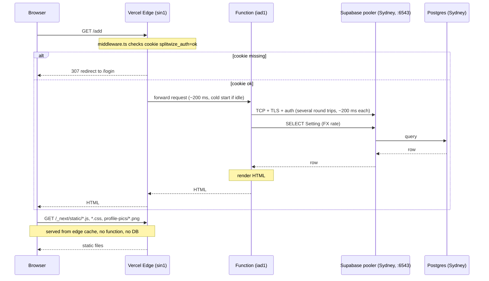
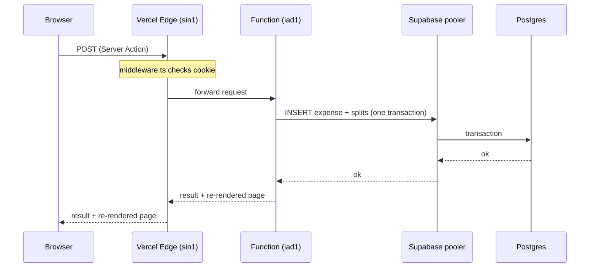

# Request flow diagrams

How a request travels from the browser through Vercel to Supabase. Latency figures are rough estimates, not measurements.

Vercel's edge network handles the CDN, routing and middleware. The function (the Next.js server code) is the web app, and it is the only component that talks to Supabase.

## Page load: GET /add (logged in)



## Form submit: Server Action `addExpense`



## Where the time goes on /add

- Edge to function: one long hop (Singapore to US East), both ways.
- Function to Supabase: a new connection needs TCP, TLS and auth round trips before the query. Each one crosses to Sydney. A warm instance reuses its connection, so only the query costs a round trip.
- Pooler to Postgres: inside Supabase, fast.

With the function region set next to the DB (`syd1`, or `sin1` after moving the project), the function to pooler round trips drop from about 200 ms each to a few ms.

Check the function region with:

```bash
curl -sI https://splitwize-vietnam.vercel.app/login | grep -i x-vercel-id
```

In `x-vercel-id: sin1::iad1::...` the first code is the edge and the second is the function region.
